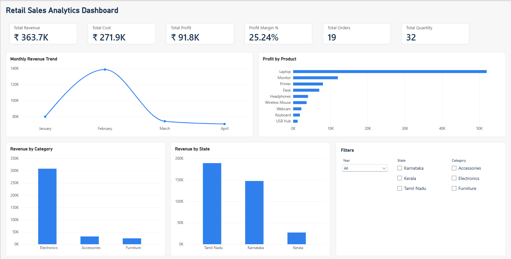

# Retail Sales ETL & Analytics Pipeline

An end-to-end data analytics project that demonstrates how raw retail sales data can be cleaned, transformed, stored, validated, and analyzed using Python, SQL Server, and Power BI.

## Project Overview

This project simulates a real-world retail data pipeline:

Excel → Python/Pandas → SQL Server → Power BI

The raw Excel data contains customers, products, and sales transactions. Python is used for data quality checks and cleaning. The cleaned data is loaded into SQL Server using a dimensional data warehouse structure and validated using SQL queries. Power BI is then used to create an interactive sales analytics dashboard.

## Technologies Used

- Excel
- Python
- Pandas
- SQL Server
- SQL
- Power BI
- DAX

## Project Workflow

1. Raw retail data created in Excel
2. Data quality checks performed using Python/Pandas
3. Duplicate and invalid records identified
4. Invalid records separated into an exceptions file
5. Clean data exported as CSV
6. Clean data loaded into SQL Server staging tables
7. Dimensional data warehouse created
8. Fact and dimension tables populated
9. SQL validation and analysis performed
10. SQL Server connected to Power BI
11. DAX measures created
12. Interactive dashboard developed

## Data Quality Checks

The Python ETL process checks for:

- Duplicate Sales IDs
- Invalid Product IDs
- Invalid quantities
- Invalid dates
- Data type issues

### ETL Results

- Raw sales rows: 23
- Clean sales rows: 19
- Exception rows: 4

The exceptions consisted of invalid quantity, invalid product ID, and duplicate sales records.

## Data Warehouse Model

### Dimension Tables

- DimCustomer
- DimProduct
- DimDate

### Fact Table

- FactSales

The warehouse follows a basic star-schema structure with the dimension tables connected to the FactSales table.

## Key SQL Analysis

The SQL validation process calculates:

- Total Sales Rows
- Total Quantity
- Total Revenue
- Total Cost
- Total Profit

### Validated Results

| Metric | Value |
|---|---:|
| Sales Rows | 19 |
| Total Quantity | 32 |
| Total Revenue | ₹363,700 |
| Total Cost | ₹271,900 |
| Total Profit | ₹91,800 |

## Power BI Dashboard

The Power BI dashboard contains:

- Total Revenue
- Total Cost
- Total Profit
- Profit Margin %
- Total Orders
- Total Quantity
- Monthly Revenue Trend
- Profit by Product
- Revenue by Category
- Revenue by State
- Year filter
- State filter
- Category filter



## Project Structure

```text
Retail_ETL_Project/
│
├── raw/
│   ├── Customers.xlsx
│   ├── Products.xlsx
│   └── Sales.xlsx
│
├── python_etl/
│   └── etl.py
│
├── processed/
│   ├── customers_clean.csv
│   ├── products_clean.csv
│   ├── sales_clean.csv
│   └── sales_exceptions.csv
│
├── sql/
│   ├── 01_create_database.sql
│   ├── 02_create_staging.sql
│   ├── 03_create_warehouse.sql
│   └── 04_validation_queries.sql
│
├── powerbi/
│   └── Retail_Sales_Analytics.pbix
│
├── screenshots/
│   └── dashboard.png
│
└── README.md